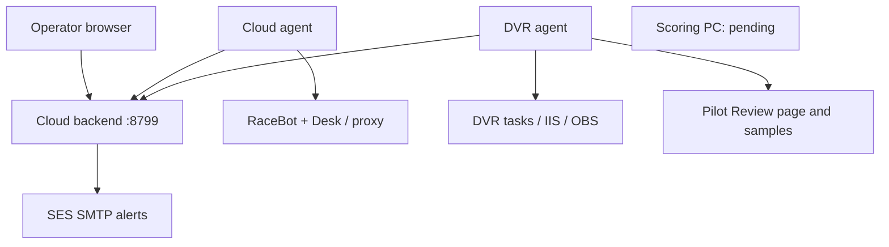

# Architecture

The browser is served by the backend and refreshes authenticated status every five seconds. The cloud agent polls loopback endpoints and disk capacity. The DVR agent sends outbound heartbeats, reads local task/log/OBS evidence and performs bounded public Pilot Review probes. No inbound management listener is installed on the DVR PC. Scoring has no active management implementation.

Recovery commands are queued on the backend and delivered in the appropriate host's heartbeat response. The agent executes a fixed action locally and reports its outcome. The browser cannot supply an executable, shell command, task name or process ID. Request IDs, persistent execution journals, host binding, current evidence, capability checks and cooldowns constrain execution. A crash after dispatch yields uncertainty rather than automatic replay.

The SES alert engine stores incidents/mutes in the backend database. A monitor staying red for 30 seconds generates one notification per incident. Healthy/degraded recovery permits a future incident; unknown does not count as recovery. Backend/whole-cloud failure cannot send its own outage email: independent external monitoring is still needed.

The live topology is SVG built by `cloud/web/app.js` using the same evidence helper as the monitor rows. IDs are host-scoped. Links focus/open the exact detailed row without triggering recovery. Collapse preference is browser-local; mute preferences are server-persistent. Phone navigation positions the scrollable map on a selected PC/S3 area. Static lines/port badges preserve the supplied drawing and are not live network tests.

Code ownership and contracts remain separate from the managed products: RaceBot/PitWall in `dougkling/RaceBot`; Race DVR in `dougkling/dvr`; other broadcast/selector/analytics projects remain independent. Their full source is not duplicated here.
